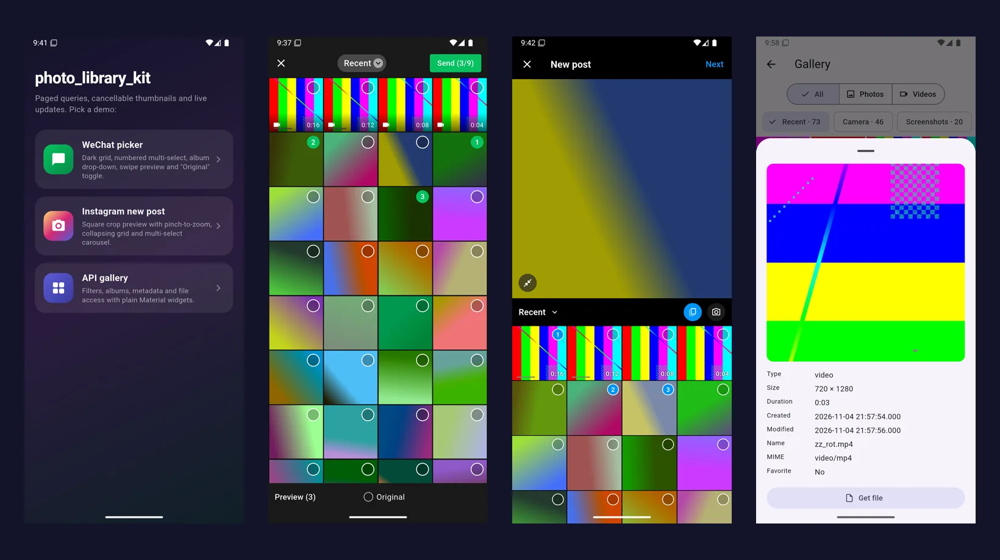
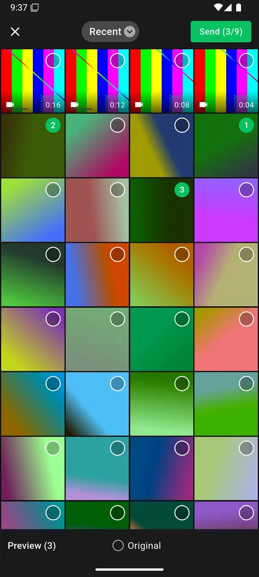
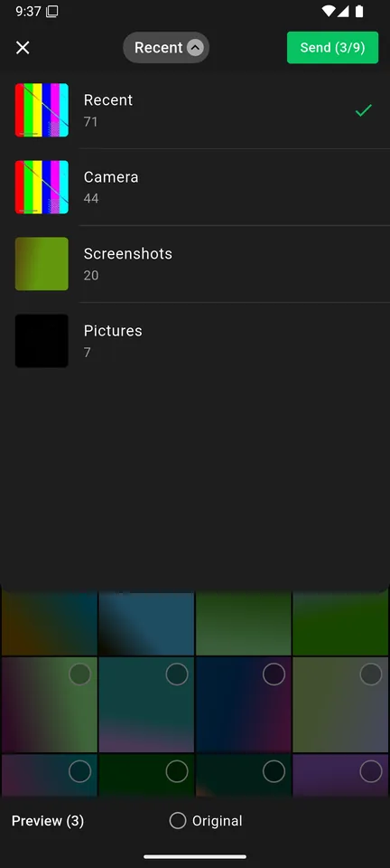
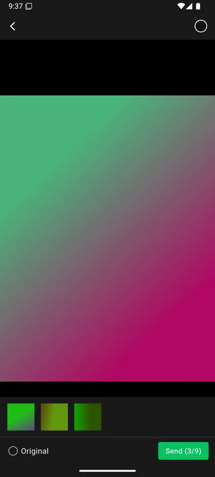
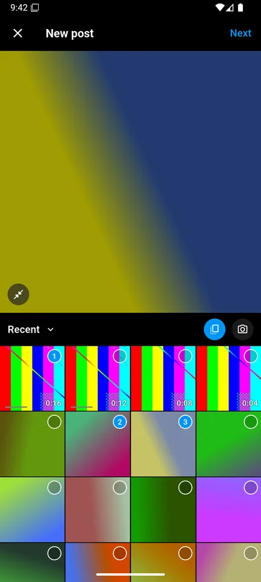
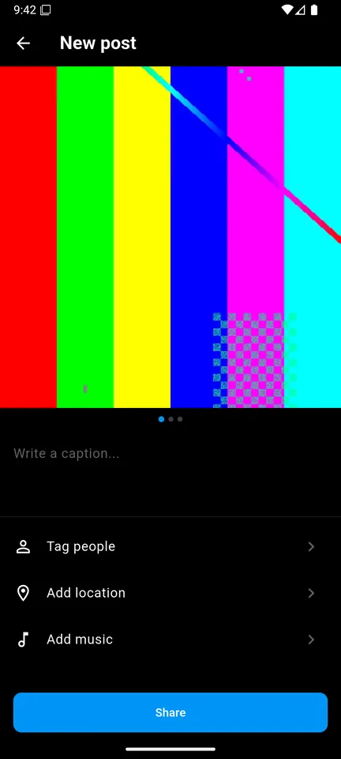
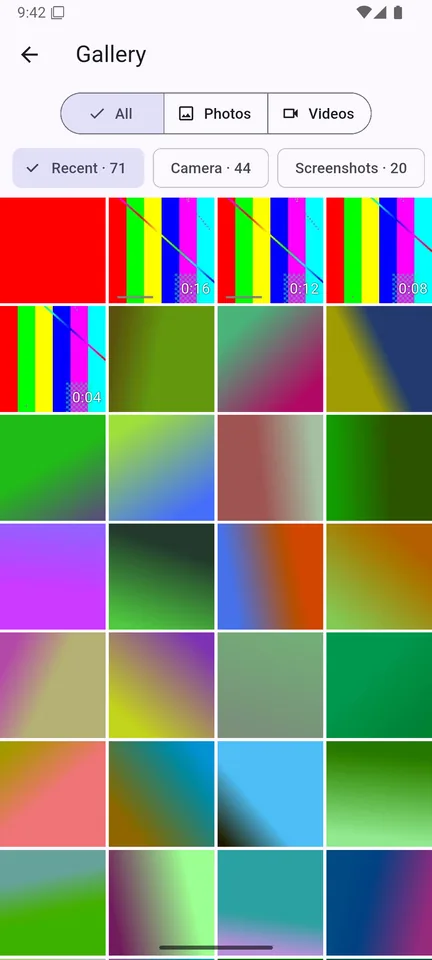

# photo_library_kit: fast Flutter photo gallery & media picker library

[](https://pub.dev/packages/photo_library_kit)
[](https://pub.dev/packages/photo_library_kit/score)
[](https://pub.dev/packages/photo_library_kit/score)
[](https://github.com/winterzxzz/photo_library_kit/blob/main/LICENSE)


**photo_library_kit** is a Flutter plugin for reading the device **photo
library and video gallery** on **Android** (MediaStore) and **iOS**
(PhotoKit). It is built for speed: paged asset queries, cancellable cached
thumbnails, and a live change stream. You can use it to build your own **image
picker**, **gallery app**, **multi-select media picker**, or **WeChat /
Instagram-style picker** without loading the whole library into memory.

It covers the same ground as `photo_manager`, but its API is built around
smooth scrolling in very large libraries.



## Contents

- [Features](#features)
- [Screenshots](#screenshots)
- [Installation](#installation)
- [Quick start](#quick-start)
- [Build a photo grid](#build-a-photo-grid)
- [Full-screen image preview](#full-screen-image-preview)
- [Filter photos and videos](#filter-photos-and-videos)
- [Files, saving and deleting](#files-saving-and-deleting)
- [Listen for gallery changes](#listen-for-gallery-changes)
- [Permissions and limited access](#permissions-and-limited-access)
- [Performance](#performance)
- [Example apps](#example-apps)
- [Platform support](#platform-support)
- [FAQ](#faq)
- [License](#license)

## Features

- 📷 **Photos and videos** from the device gallery, including albums,
  Android folders, iOS smart albums, favorites and Live Photos.
- 📜 **Paged queries**: `AssetPagedList` loads 100k+ asset libraries page by
  page and keeps memory flat with an LRU page cache.
- ⚡ **Fast thumbnails**: decoded natively at the exact size, scheduled LIFO so
  visible cells load first, and **cancelled** natively when a cell scrolls away.
- 🖼️ **Drop-in widgets**: `AssetThumbnail` and `MediaImageProvider` work with
  `Image`, `GridView` and Flutter's `ImageCache`.
- 🔍 **Native filtering** by media type, date range and video duration, with
  sorting.
- 🔄 **Live updates**: a debounced change stream with inserted, updated and
  removed ids; lists refresh themselves without flicker.
- 🔐 **Permissions**, including **limited access** ("Selected Photos" on iOS
  14+, partial access on Android 14+).
- 💾 **File access**: get the original or edited file, save images and videos to
  the gallery, and delete assets with the system confirmation dialog.
- 🧪 **Testable**: swap in a fake `PhotoLibraryPlatform` in unit tests.

## Screenshots

| WeChat-style picker | Album switcher | Swipe preview |
|:---:|:---:|:---:|
|  |  |  |

| Instagram-style new post | Post carousel | API gallery |
|:---:|:---:|:---:|
|  |  |  |

## Installation

```yaml
dependencies:
  photo_library_kit: ^0.1.0
```

### Android setup

Nothing to add. The plugin declares `READ_MEDIA_IMAGES`,
`READ_MEDIA_VIDEO`, `READ_MEDIA_VISUAL_USER_SELECTED`, and the legacy storage
permissions with `maxSdkVersion`. To remove the ones you don't need, use
`tools:node="remove"` in your app manifest. Google Play allows `READ_MEDIA_*`
only for apps whose core feature needs broad media access.

### iOS setup

Add these keys to `ios/Runner/Info.plist`:

```xml
<key>NSPhotoLibraryUsageDescription</key>
<string>Pick photos and videos to share.</string>
<key>NSPhotoLibraryAddUsageDescription</key>
<string>Save photos to your library.</string>
<!-- Optional: hide the system limited-access alert if you show your own -->
<key>PHPhotoLibraryPreventAutomaticLimitedAccessAlert</key>
<true/>
```

Minimum iOS 15. CocoaPods and Swift Package Manager are both supported.

## Quick start

```dart
import 'package:photo_library_kit/photo_library_kit.dart';

final state = await PhotoLibrary.requestPermission();
if (!state.hasAccess) {
  await PhotoLibrary.openSettings();
  return;
}

final albums = await PhotoLibrary.getAlbums(filter: MediaFilter.images);
final recent = albums.first; // the virtual "all photos" album is first
final firstPage = await recent.getAssets(end: 60);
```

## Build a photo grid

A smooth, lazily loaded gallery grid takes about 15 lines:

```dart
class Gallery extends StatefulWidget {
  const Gallery({super.key});

  @override
  State<Gallery> createState() => _GalleryState();
}

class _GalleryState extends State<Gallery> {
  final assets = AssetPagedList()..load(); // also watches library changes

  @override
  void dispose() {
    assets.dispose();
    super.dispose();
  }

  @override
  Widget build(BuildContext context) => ListenableBuilder(
        listenable: assets,
        builder: (context, _) => GridView.builder(
          gridDelegate: const SliverGridDelegateWithFixedCrossAxisCount(
            crossAxisCount: 4,
          ),
          itemCount: assets.length,
          itemBuilder: (context, i) {
            final asset = assets[i]; // null while its page loads
            return asset == null
                ? const ColoredBox(color: Colors.black12)
                : AssetThumbnail(asset: asset);
          },
        ),
      );
}
```

`AssetThumbnail` picks its pixel size from the layout and the device pixel
ratio. It rounds that size into buckets so similar cells share cache entries,
fades in only when the image wasn't cached, and cancels the native request on
dispose.

## Full-screen image preview

```dart
Image(image: MediaImageProvider.preview(asset, longestSide: 2048));
```

Previews are decoded natively with subsampling, so memory scales with the
screen size, not the camera resolution. For an instant placeholder, show the
cached grid thumbnail underneath; see
[`example/lib/wechat/wechat_preview.dart`](https://github.com/winterzxzz/photo_library_kit/blob/main/example/lib/wechat/wechat_preview.dart).

## Filter photos and videos

```dart
final filter = MediaFilter(
  types: {MediaType.video},
  minVideoDuration: const Duration(seconds: 3),
  createdAfter: DateTime.now().subtract(const Duration(days: 30)),
  sort: MediaSort.newest,
);

final count = await PhotoLibrary.getAssetCount(filter: filter);
final videos = AssetPagedList(filter: filter)..load();
```

Filters are compiled to SQL (Android) or `NSPredicate` (iOS), so only matching
rows cross the platform channel.

## Files, saving and deleting

```dart
final file = await asset.file();                    // display version
final original = await asset.file(original: true);  // unedited original

await PhotoLibrary.saveImage(bytes, filename: 'edit.jpg');
await PhotoLibrary.saveVideo('/path/to/clip.mp4');

final deleted = await PhotoLibrary.deleteAssets([asset]); // system confirms
await PhotoLibrary.clearFileCache(); // removes files exported on iOS
```

## Listen for gallery changes

```dart
final sub = PhotoLibrary.changes.listen((change) {
  debugPrint('${change.insertedIds.length} new photos');
});
```

The native observer runs only while the stream has listeners.
`AssetPagedList` uses this stream to refresh itself.

## Permissions and limited access

```dart
final state = await PhotoLibrary.requestPermission();

switch (state) {
  case PermissionState.authorized:
    break; // full library
  case PermissionState.limited:
    // The user picked specific photos. Let them change the selection:
    await PhotoLibrary.presentLimitedPicker();
  case PermissionState.denied:
  case PermissionState.restricted:
    await PhotoLibrary.openSettings();
  case PermissionState.notDetermined:
    break;
}
```

## Performance

What keeps scrolling at 60/120 fps in large libraries:

| Technique | Where |
|---|---|
| Only the count is fetched up front; pages load on demand and are LRU-cached | `AssetPagedList` |
| Concurrent requests for the same page share one platform call | `AssetPagedList` |
| Thumbnails decoded natively at the target size (no full-resolution decode) | Android `ThumbnailLoader`, iOS `PHCachingImageManager` |
| LIFO queue with a concurrency cap: visible cells first | `ThumbnailScheduler` |
| Off-screen requests cancelled in Dart *and* natively | `ThumbnailScheduler`, `AssetThumbnail` |
| Cache key includes the modification date: no stale thumbnails after edits | `MediaImageProvider` |
| Narrow single-pass album query on Android; cached fetch results on iOS | native |

Tips:

- Use the same `ThumbnailOptions` for the grid and the preview placeholder so
  both hit one `ImageCache` entry.
- Increase `ImageCache.maximumSize` for very dense grids.
- Call `PhotoLibrary.startCaching` (iOS) for cells you know will appear next.

## Example apps

The [`example/`](https://github.com/winterzxzz/photo_library_kit/tree/main/example)
app includes three demos:

- **WeChat-style image picker**: dark grid, numbered multi-select (up to 9),
  album drop-down, swipe and zoom preview with a selection strip, and an
  "Original" toggle. It feeds a Moments-style composer.
- **Instagram-style new post**: square crop preview with pinch-to-zoom and a
  rule-of-thirds grid, pinned album header, multi-select (up to 10), and a
  carousel share page.
- **API gallery**: photo and video filters, albums, metadata and file access.

```bash
cd example
flutter run
```

## Platform support

| | Android | iOS |
|---|---|---|
| Minimum version | 7.0 (API 24) | 15.0 |
| Full / limited permission | ✅ / ✅ (14+) | ✅ / ✅ (14+) |
| Albums | Folders (buckets) | Smart albums + user albums |
| Thumbnails | `loadThumbnail` / `ImageDecoder` | `PHCachingImageManager` |
| Change details (ids) | ✅ (11+) | ✅ |
| Save / delete | ✅ (delete dialog on 11+) | ✅ |

Platform notes:

- On Android, sorting and date filters (`createdAfter`/`createdBefore`) use
  `DATE_ADDED`, while `createdAt` reports the capture date when it is known.
  iOS uses `creationDate` for all three.
- `MediaFilter.includeGifs` works on Android only; PhotoKit has no predicate
  for GIFs.
- On iOS, `title` and `mimeType` are filled only by `getAsset`, because they need
  a slower resource lookup that paging skips.
- Android 10 can delete only media the app owns, unless the user consents for
  each item.

## FAQ

**Is this an alternative to photo_manager?**
Yes. It covers the same core use cases: albums, assets, thumbnails, files, save
and delete, and permissions. The API is built around paging, cancellation and
ready-to-use widgets.

**How do I build a WeChat-style or Instagram-style image picker in Flutter?**
Combine `AssetPagedList`, `AssetThumbnail` and `MediaImageProvider.preview`.
The [example app](https://github.com/winterzxzz/photo_library_kit/tree/main/example/lib)
contains complete implementations of both that you can copy and adapt.

**Does it support Android 14 partial photo access and iOS limited library?**
Yes. Both return `PermissionState.limited`, and `presentLimitedPicker()` lets
the user change the selection.

**How do I show video duration or detect GIFs and Live Photos?**
Use `asset.duration`, `asset.isGif` and `asset.isLivePhoto`.

**How do I unit test code that uses the photo library?**
Set `PhotoLibraryPlatform.instance = MyFakePlatform();`. See
[`test/fake_platform.dart`](https://github.com/winterzxzz/photo_library_kit/blob/main/test/fake_platform.dart).

## Contributing

Bug reports and pull requests are welcome on
[GitHub](https://github.com/winterzxzz/photo_library_kit/issues).

## License

MIT © winterzxzz. See [LICENSE](https://github.com/winterzxzz/photo_library_kit/blob/main/LICENSE).
